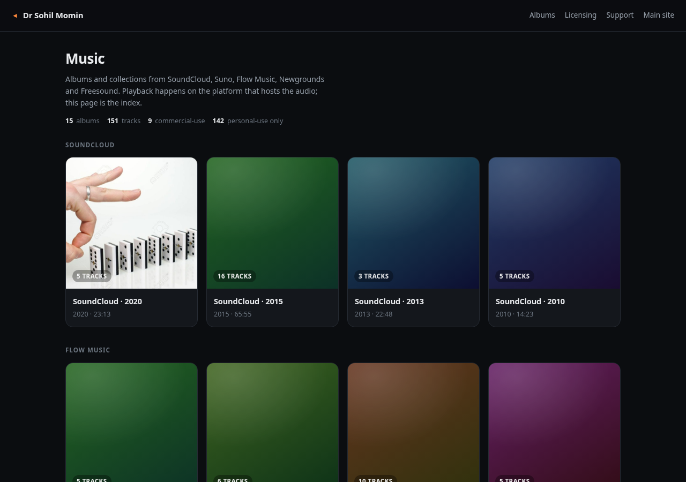

# music

Album-wise music page for Dr Sohil Momin, served at https://drsamonline.github.io/music/

Audio is **not** hosted here. Each track points at the platform that hosts it (SoundCloud, Suno,
Flow Music, Newgrounds, Freesound) and the page plays it through that platform's own player, or
opens it in a new tab where no player page exists.

## What is where

| Path | Purpose |
|---|---|
| `index.html`, `styles.css`, `*.js` | the page. No build step, no dependencies. |
| `data/tracks.json` | the manifest the page reads. Generated — do not hand-edit. |
| `sources/seed.json` | crawled catalogue: profiles, tracks, licences, duplicates, takes. |
| `sources/*.links.txt` | the link list per platform, one URL per line. |
| `tools/build_manifest.py` | seed + link lists -> `data/tracks.json`. |
| `.github/workflows/` | rebuild manifest on push, deploy to Pages. |

## Add a track

1. Put the track link in `sources/<platform>.links.txt`.
2. Re-crawl that platform (or paste the row straight into `sources/seed.json`).
3. Push. `rebuild.yml` regenerates `data/tracks.json` and `deploy.yml` publishes it.

## Licence rule

Two tiers only, decided at ingest, never in the browser:

* `commercial` — stream free; commercial use is permitted by the source (own work, CC-BY-SA, or a
  paid Suno download).
* `personal` — stream free; no commercial use (CC-BY-NC*, everything on Flow Music until cleared,
  Suno downloads of unverified tier).

Anything uncertain lands in `personal`. Silence never grants rights.

## Duplicates and takes

* Different platform + same title = one song. Merged; the playable copy is primary and the other
  appears under "also on".
* Same platform + same title = separate takes (Suno generates two per prompt). Never merged.

## Deploy

Pages serves the repository root. `deploy.yml` publishes on every push to `main`.

## Support

If this is useful to you, the work is supported here:

- **Email** — [sohilmomin2000@gmail.com](mailto:sohilmomin2000@gmail.com) for bugs, corrections and licensing questions.
- **UPI** — `drsohilboi@ybl`
- **Ko-fi** — [ko-fi.com/drsamonline](https://ko-fi.com/drsamonline)
- **PayPal** — [paypal.me/drsamonline](https://paypal.me/drsamonline)

The page itself is free and uncommercial; a commercial licence is for using the recordings in paid work.
